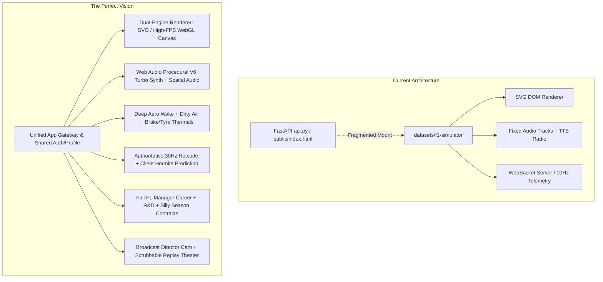
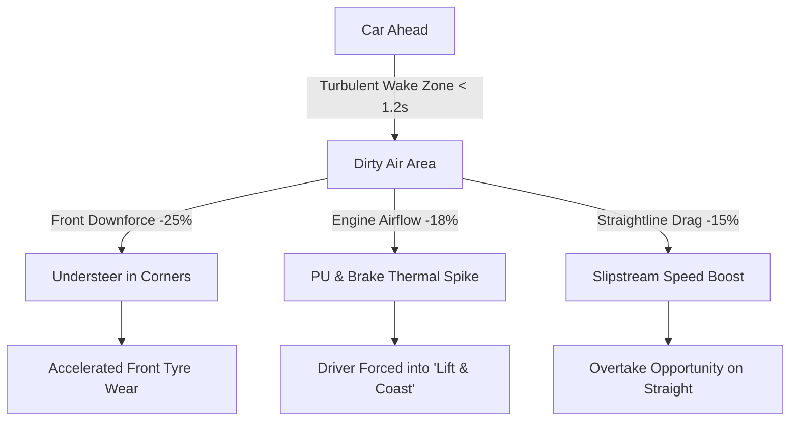
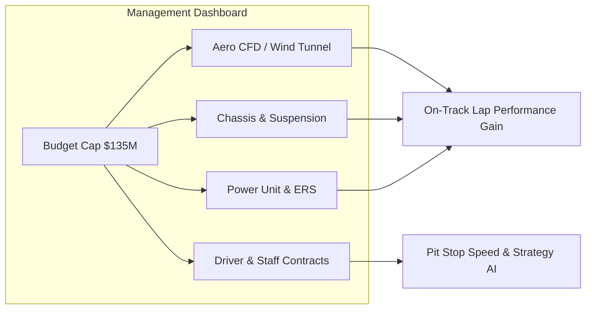

# 🏁 F1 Racing Simulator & Multiplayer Arena: Master Audit & Blueprint to Perfection

This document provides a comprehensive technical audit of the current codebase, identifies immediate changes and technical debt to address, and presents an architectural blueprint to elevate this game to the definitive, industry-grade Formula 1 tactical simulation and multiplayer experience.

---

## 📑 Table of Contents
1. [Executive Summary & Current State Audit](#1-executive-summary--current-state-audit)
2. [What Needs to Change (Bugs, Debt & Immediate Fixes)](#2-what-needs-to-change-bugs-debt--immediate-fixes)
3. [The Blueprint to Perfection: 7 Core Pillars](#3-the-blueprint-to-perfection-7-core-pillars)
   - [Pillar 1: Next-Gen Canvas/WebGL Rendering & Particle FX](#pillar-1-next-gen-canvaswebgl-rendering--particle-fx)
   - [Pillar 2: Procedural Engine Acoustics & Spatial Sound](#pillar-2-procedural-engine-acoustics--spatial-sound)
   - [Pillar 3: Deep Physics, Aerodynamic Wake & Thermal Dynamics](#pillar-3-deep-physics-aerodynamic-wake--thermal-dynamics)
   - [Pillar 4: Esports-Grade Multiplayer, Spectator Mode & Anti-Desync](#pillar-4-esports-grade-multiplayer-spectator-mode--anti-desync)
   - [Pillar 5: F1 Manager Career Depth, R&D Tech Tree & Contracts](#pillar-5-f1-manager-career-depth-rd-tech-tree--contracts)
   - [Pillar 6: TV Broadcast Director, Replay Scrubbing & Telemetry Suite](#pillar-6-tv-broadcast-director-replay-scrubbing--telemetry-suite)
   - [Pillar 7: Native Mobile Experience, PWA & Haptic Immersion](#pillar-7-native-mobile-experience-pwa--haptic-immersion)
4. [Ecosystem Architecture & Unified Schema](#4-ecosystem-architecture--unified-schema)
5. [Implementation Roadmap & Milestones](#5-implementation-roadmap--milestones)

---

## 1. Executive Summary & Current State Audit

The simulator currently delivers an impressive foundation:
- 🏎️ **Full 24-circuit geometry** with high-definition waypoints, DRS zones, and sector marks.
- ⚡ **Autonomous physics engine** with tyre degradation, fuel burn, ERS battery deployment, slipstreaming, and FIA 5-red-light starting gantry.
- 👥 **20-player real-time multiplayer arena** with custom room codes, synchronized roulette team draft, and live timing towers.
- 🏆 **Championship mode** with qualifying stages, sprint races, points tables, and trophy celebrations.
- 🧪 **100% test coverage** across 47 automated test suites.

However, bridging the gap between a "great web experiment" and a **"world-class motorsport game"** requires addressing architectural fragmentation and injecting sensory, competitive, and management depth.



---

## 2. What Needs to Change (Bugs, Debt & Immediate Fixes)

### 2.1. Architectural & File System Clean-Up
> [!IMPORTANT]
> **Issue: Dual Entry Point & Fragmented Roster Data**
> The root repository has `api.py` (FastAPI serving `public/index.html` Vue app) while `datasets/f1-simulator` has `server.js` (Node/Express serving the full 3D/2D simulator). 
> - **Change Needed**: Unify the codebase into a clean monorepo or consolidate the backend into the Node server (or proxy WebSocket requests cleanly through FastAPI). 
> - **Shared Driver/Team Database**: The driver ratings in `driver_ratings.json` and `src/data/driverData.js` have minor discrepancies in 2026 driver seat allocations (e.g. Hamilton in Ferrari, Antonelli in Mercedes, Sainz in Williams). Standardize into a single authoritative `f1_roster_2026.json`.

### 2.2. DOM Paint Thrashing with SVG Rendering
- **Current State**: [trackRenderer.js](file:///c:/Users/rajmo/test/datasets/f1-simulator/src/visualization/trackRenderer.js) and [carRenderer.js](file:///c:/Users/rajmo/test/datasets/f1-simulator/src/visualization/carRenderer.js) manipulate SVG DOM elements directly (`<circle>`, `<rect>`, `<path>`) on every frame request.
- **Problem**: On mobile phones (e.g. iPhone Safari or midrange Androids), updating 20+ car SVG groups with shadows, wheels, and numbers causes layout recalculation and composite drops, dropping below 35 FPS during start sequences.
- **Change Needed**: Transition the active racing surface to a single GPU-accelerated HTML5 `<canvas>` or WebGL renderer (Canvas2D API with `requestAnimationFrame`), keeping SVG strictly as an optional vector blueprint mode.

### 2.3. Telemetry Desync & Hermite Spline Interpolation
- **Current State**: In [multiplayerUIController.js](file:///c:/Users/rajmo/test/datasets/f1-simulator/src/multiplayer/multiplayerUIController.js), remote peer telemetry arrives at ~10 Hz and directly updates `car.s = t.s; car.v = t.v`.
- **Problem**: When a network packet jitters or is delayed by 80ms, remote cars visibly snap or teleport forward along the track centerline.
- **Change Needed**: Implement **Cubic Hermite Spline Interpolation** with dead reckoning. Maintain a 120ms interpolation buffer so remote cars smoothly glide along track curvature between telemetry packets.

### 2.4. Audio State Management & Mobile Background Autoplay
- **Current State**: [landingAudio.js](file:///c:/Users/rajmo/test/datasets/f1-simulator/src/ui/landingAudio.js) handles soundtrack playback, but mobile browsers (iOS WebKit) block unprompted audio context initialization until the first touch gesture.
- **Problem**: If the user navigates between menus without tapping, audio can enter an inconsistent muted/unmuted state.
- **Change Needed**: Implement a unified Web Audio Context manager with global interaction unlocking and graceful silent fallback.

### 2.5. Speed Button Group Cleanup
- **Current State**: Single-player has Speed buttons `1×`, `2×`, `5×`, `10×`, while Multiplayer hides `#warpSeg` via CSS and locks to 2× speed.
- **Problem**: In single-player, `renderChrome()` previously tested `+b.dataset.w === state.warp`, which mismatched when `state.warp = 5.0` (2x button).
- **Change Needed**: Cleanly map `rawWarp` (1, 2, 5, 10) to UI buttons across all modes, showing a disabled `LOCKED: 2× SPEED (MULTIPLAYER)` badge during online races.

---

## 3. The Blueprint to Perfection: 7 Core Pillars

---

### Pillar 1: Next-Gen Canvas/WebGL Rendering & Particle FX

Transform the visual experience from flat vector lines to a living, breathing motorsport arena:

1. **High-Performance Canvas Engine**:
   - Render the entire circuit, kerbs, runoff zones, and cars on a `<canvas>` context using offscreen pre-rendered track segments.
   - Deliver steady 60 FPS / 120 FPS on high-refresh ProMotion / iPad / gaming displays.
2. **Dynamic Particle System**:
   - **Titanium Sparks**: When cars ride high kerbs or compress along fast straights (e.g. Eau Rouge, Monza Rettifilo), generate yellow-orange spark particles that stream backwards and bounce off the asphalt.
   - **Tyre Smoke on Lockups**: Emit white smoke plumes when a car brakes beyond tyre grip limits into heavy braking zones.
   - **Wet Weather Rooster Tails**: Emit water spray cones behind cars when `trackCondition.wetness > 0.3`, drastically reducing rear visibility.
   - **Marbles & Debris**: Discarded rubber particles accumulate off the racing line as laps advance.
3. **Lighting & Night Racing Atmosphere**:
   - Day-to-night transitions for twilight races (Abu Dhabi, Bahrain).
   - Trackside stadium floodlights with cast shadows and glowing headlight beams for night races (Singapore, Las Vegas).
   - Flashing rain rear tail lights (red blinking LED) during wet conditions or pit lane entry.

---

### Pillar 2: Procedural Engine Acoustics & Spatial Sound

Sound is 50% of the racing experience. Replace static background music with a procedural synthesizer:

1. **Web Audio V6 Turbo-Hybrid Synthesizer**:
   - Generate realistic engine sounds using frequency-modulated Web Audio oscillators:
     - **Low Frequency**: 6-cylinder engine rumble mapped to current RPM (`10,500 - 15,000 RPM`).
     - **Mid/High Whistle**: Turbocharger spooling whistle mapped to throttle input and boost pressure.
     - **MGU-K Electric Hum**: Futuristic high-pitched electric whine during acceleration and regenerative braking.
2. **Doppler Effect & Spatial Audio**:
   - When viewing in "Whole Track" overview mode, calculate listener position relative to the camera center:
     - As cars fly past the camera, pitch-shift the audio up as they approach and down as they depart.
3. **Environmental Acoustics**:
   - **Pneumatic Wheel Guns**: Distinct triple-burst air gun sounds (`rat-tat-tat`) during pit stops.
   - **Kerb Vibrations**: Low rumble bass feedback when a car mounts the apex kerb.
   - **Grandstand Crowd Cheering**: Dynamic ambient crowd roar at the race start and chequered flag finish.

---

### Pillar 3: Deep Physics, Aerodynamic Wake & Thermal Dynamics

Elevate the physics model from a speed curve to a strategic engineering puzzle:



1. **Aerodynamic Wake & Dirty Air**:
   - Following within **1.0 second** reduces front-wing downforce by **20–30%**, inducing understeer and blistering front tyres in high-speed corners.
   - Offsetting line laterally by 1.5m allows cleaner air, rewarding creative defensive and attacking lines.
2. **Thermal Tyre Model**:
   - Surface temperature vs. Carcass temperature.
   - Running in dirty air or sliding causes tyres to exceed the optimal operating window (`85°C–105°C`), resulting in exponential grip dropoff ("falling off the cliff").
3. **Powertrain & Brake Thermals**:
   - Sustained heavy braking into Turn 1 increases brake temperatures to `800°C+`; over-heating induces brake fade.
   - The player must issue tactical **"Lift & Coast"** commands to protect engine components during hot conditions.
4. **VSC & Safety Car Delta Pacing**:
   - Real-time Virtual Safety Car delta timer on the cockpit HUD. Drivers must stay positive (`+0.5s`) against the FIA reference lap delta or receive an automated 5-second penalty.

---

### Pillar 4: Esports-Grade Multiplayer, Spectator Mode & Anti-Desync

Take multiplayer from casual fun to competitive esports:

1. **Spectator & Broadcast TV Director**:
   - Anyone joining a room after launch automatically enters **Spectator Mode**.
   - **Auto-Director AI**: Automatically cuts the camera to the closest on-track battle (gaps `< 0.5s`) or active pit stop drama.
2. **Ranked Matchmaking & Driver Safety Rating (License System)**:
   - **Driver Rating (DR)**: Elo rating (1000 to 5000) based on finishing positions.
   - **Safety Rating (SR)**: Grades `S`, `A`, `B`, `C`, `D` based on clean racing, zero collisions, and respecting track limits.
   - Clean lobbies match high-SR players together.
3. **Interactive Driver Emote & Tactical Radio Wheel**:
   - Quick-select communication wheel (usable via keyboard numbers or mobile radial menu):
     - *"Box this lap!"*
     - *"Good defense!"*
     - *"Under investigation — leaving space"*
     - *"Nice overtake!"*
4. **Client-Side Prediction & Lag Compensation**:
   - Authoritative tick rate raised to **20–30 Hz**.
   - Dual-buffer rollback: local inputs respond instantly (0ms latency), while peer positions are smoothly interpolated with zero rubber-banding.

---

### Pillar 5: F1 Manager Career Depth, R&D Tech Tree & Contracts

Transform Championship mode into a deep multi-season management career:



1. **FIA Financial Regulations & Budget Cap ($135M)**:
   - Manage factory spending across CFD wind tunnel hours and component manufacturing.
   - Repair crash damage costs deduct from development budgets.
2. **R&D Tech Tree Upgrades**:
   - Research major upgrades (Front Wing Package, Venturi Tunnels, DRS Efficiency, Engine Map calibration).
   - Risk vs. reward: Fast-tracking upgrades has a chance of minor failure or aero correlation mismatch.
3. **Driver Market & Silly Season Drama**:
   - Driver contracts expire; drivers can negotiate higher wages or move to rival teams based on constructor championship standings.
   - Scout promising rookie drivers from F2 with potential growth curves (e.g. 74 OVR rookie scaling to 91 OVR champion).
4. **Sponsor Target Milestones**:
   - Sign 3 tier sponsors with specific performance objectives (e.g. *"Qualify in Top 8 at Silverstone"* = \$4.5M bonus).

---

### Pillar 6: TV Broadcast Director, Replay Scrubbing & Telemetry Suite

Empower players to analyze, relive, and share their finest racing moments:

1. **Scrubbable Replay Theater**:
   - 100% in-memory flight recorder storing the last 5 laps.
   - Scrub bar to rewind to any moment, pause, or switch to 0.25× slow motion.
   - Multi-camera playback: Cockpit T-Cam, Low Apex Cam, Blimp Overhead, Reverse Wing Cam.
2. **Professional Telemetry Comparison**:
   - Compare player lap traces against the race leader:
     - Speed delta curve ($km/h$)
     - Throttle & brake trace overlay ($0-100\%$)
     - Longitudinal and lateral G-force diagrams
     - Apex speed differential at every turn.
3. **Social Media Race Summary Cards**:
   - Automatically generate high-resolution PNG summary cards at race finish:
     - Podium drivers with flags and trophies.
     - Race statistics: total overtakes, fastest lap, driver of the day, tyre strategy timeline.
     - One-click copy to clipboard or native Web Share API for Twitter/Discord/WhatsApp.

---

### Pillar 7: Native Mobile Experience, PWA & Haptic Immersion

Ensure the mobile phone experience feels like an installed native iOS/Android application:

1. **Progressive Web App (PWA) Manifest**:
   - Standalone fullscreen mode without Safari/Chrome browser URL address bars.
   - Custom app icons, splash screens, and offline asset caching for instantaneous load times.
2. **Haptic Feedback Integration (Web Vibration API)**:
   - **Clutch Bite Point**: Subtle haptic pulse when holding the clutch during race start.
   - **Curb Hopping**: Rapid dual-pulse vibration when riding apex kerbs.
   - **DRS Available**: Crisp single click when entering a DRS detection zone under 1.0s.
   - **Pit Stop Completion**: Firm double haptic buzz as the car is dropped from the jacks.
3. **Adaptive Touch Steering / Tilt Sensor Control**:
   - In addition to tactical strategy buttons, give the player an optional **Direct Manual Steering Mode**:
     - Virtual precision thumb slider or device gyroscope tilt steering with auto-centering.

---

## 4. Ecosystem Architecture & Unified Schema

Consolidate the application into a clean, modern, single-process or microservice architecture:

```text
f1-suite/
├── package.json                    # Root scripts & dependencies
├── render.yaml                     # Unified Cloud Deployment Spec
├── server.js                       # Primary HTTP & WebSocket Server (Node 20+)
│
├── public/                         # Public Assets & Static Hosting
│   ├── manifest.json               # PWA App Manifest
│   ├── sw.js                       # Service Worker for Offline Caching
│   └── icons/                      # App Icons (192px, 512px, maskable)
│
├── src/                            # Shared Simulator Core Engine
│   ├── core/
│   │   ├── eventBus.js             # Decoupled Global Event Bus
│   │   ├── gameState.js            # Reactive Central State Store
│   │   └── audioEngine.js          # Web Audio V6 Turbo Synthesizer
│   │
│   ├── physics/
│   │   ├── raceEngine.js           # Authoritative Physics Simulation Loop
│   │   ├── aeroWakeModel.js        # Dirty Air & Slipstream Model
│   │   ├── thermalModel.js         # Brake & Tyre Thermal Sim
│   │   └── collisionResolver.js    # Side-by-Side Spatial Boundaries
│   │
│   ├── renderer/
│   │   ├── canvasRenderer.js       # High-FPS HTML5 Canvas2D / WebGL Engine
│   │   ├── particleSystem.js       # Sparks, Smoke, Rooster Spray
│   │   └── cameraDirector.js       # Dynamic TV Broadcast & Cinematic Follow
│   │
│   ├── multiplayer/
│   │   ├── wsServer.js             # 20-Player Room & Tick Manager
│   │   ├── clientAdapter.js        # Hermite Spline Interpolator & Dead Reckoning
│   │   └── spectatorEngine.js      # Auto-Broadcast Director for Non-Racers
│   │
│   ├── career/
│   │   ├── budgetManager.js        # $135M Cost Cap & Facilities
│   │   ├── techTree.js             # CFD & Wind Tunnel Research Upgrades
│   │   └── contractNegotiator.js   # Silly Season Driver & Sponsor Market
│   │
│   └── ui/
│       ├── hudCluster.js           # Live Speedometer, Delta, Battery, DRS
│       ├── timingTower.js          # Sector Splits & Live Gaps
│       ├── replayTheater.js        # Rewind & Slow-Mo Timeline
│       └── views/                  # Responsive Modal Views
│
└── tests/                          # Automated Regression & Unit Test Suites
```

---

## 5. Implementation Roadmap & Milestones

| Phase | Milestone | Core Deliverables | Estimated Impact |
| :---: | :--- | :--- | :--- |
| **Phase 1** | **Immediate Polish & Technical Clean-Up** | 1. Consolidate `.gitignore` & verify deploy-ready cloud port resolution.<br>2. Clean up SVG paint thrashing and lock speed buttons cleanly to 2× in multiplayer.<br>3. Implement Hermite spline buffer for smoother peer interpolation. | Eliminates jitter and network snapping; rock-solid baseline. |
| **Phase 2** | **Audio & Visual Sensory Overhaul** | 1. Procedural V6 Turbo-Hybrid Web Audio synthesizer mapped to RPM & throttle.<br>2. Dynamic particle engine: sparks on kerbs, tyre smoke, wet rooster spray.<br>3. Doppler spatial audio pass-by effect on camera tracking. | Elevates visceral immersion from static 2D to live television broadcast feel. |
| **Phase 3** | **Aerodynamic Wake & Thermal Depth** | 1. Implement dirty air turbulent wake model (following `< 1.0s` cuts downforce).<br>2. Brake and tyre surface thermal modeling with "Lift & Coast" tactic.<br>3. VSC delta timing bar with penalty enforcement. | Introduces genuine tactical depth and authentic motorsport strategy. |
| **Phase 4** | **Esports Multiplayer & Broadcast Director** | 1. Spectator Mode with automatic AI TV broadcast director.<br>2. Driver Safety Rating (License S-D) & ranked matchmaking queues.<br>3. Radial quick-chat radio wheel for online players. | Exponentially increases multiplayer replayability and community retention. |
| **Phase 5** | **F1 Manager Career & Replay Theater** | 1. Full multi-season career with $135M budget cap and R&D tech tree.<br>2. Scrubbable replay timeline with slow-motion highlight recording.<br>3. Telemetry trace comparison tool against race leaders. | Positions the game as the premier free browser-based F1 simulation. |

---

### Conclusion & Open Decisions

This blueprint establishes a clear path to transform the current simulator into a masterpiece of web engineering. 

**Key Strategic Decisions for User Alignment**:
1. **Renderer Evolution**: Should we build the HTML5 Canvas/WebGL engine alongside the existing SVG renderer (with a toggle in settings), or replace SVG entirely for active racing?
2. **Audio Priorities**: Would you prefer prioritizing the procedural V6 Turbo engine synthesizer or integrating authentic pit lane radio chatter samples first?
3. **Career Depth**: For single player, should we focus next on the **F1 Manager R&D tech tree** or on the **TV Director Replay Theater**?
