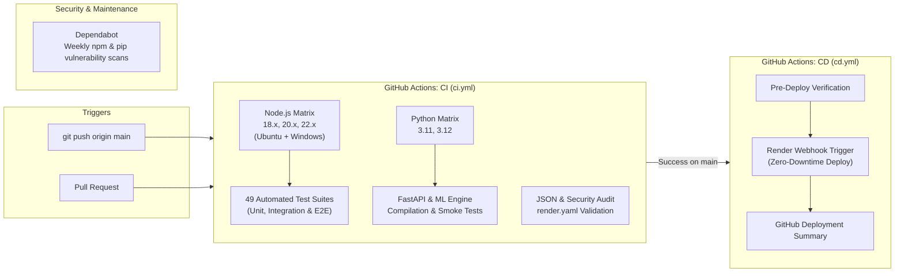

# 🏎️ Formula 1 Autonomous Racing Simulator & Multiplayer Arena (2026 Edition)

[](https://github.com/nmoger58/f1-draft/actions/workflows/ci.yml)
[](https://github.com/nmoger58/f1-draft/actions/workflows/cd.yml)
[-brightgreen.svg)](#automated-testing)
[](https://nodejs.org/)
[](https://fastapi.tiangolo.com/)
[](#multiplayer-mode)
[](LICENSE)

An advanced Formula 1 simulation ecosystem featuring physics-first autonomous multi-car racing, an authoritative 20-player real-time WebSocket arena with custom and public matchmaking, full 24-round championship seasons, starting grid roulette, interactive team radio commentary, and an ML-driven tactical draft manager.

---

## 🌟 Key Highlights & Systems

### 1. 👥 20-Player Real-Time Multiplayer Arena & Synchronisation
- **Cubic Hermite Spline Interpolation**: Third-order Hermite spline calculation across position, velocity, and continuous angular heading wrap ($-\pi \leftrightarrow +\pi$).
- **Kinematic Dead Reckoning**: Kinematic trajectory prediction with dynamic confidence decay and exponential residual error smoothing ($\mathbf{e}_{k+1} = \mathbf{e}_k \cdot e^{-8\Delta t}$) to eliminate visual snapping.
- **Authoritative Monotonic Snapshots**: 20 Hz server snapshot broadcasts with monotonic sequence numbers, simulation ticks, and timestamps.
- **60-Second Reconnection Grace**: Automatic session recovery via `sessionToken` hydration; reconnected clients restore their existing car without duplicates.
- **Multi-Finisher Leaderboard Consensus**: Independent car completion tracking where one finisher does not terminate the race for remaining competitors.
- **2× Racing Speed**: Accelerated broadcast pacing (`warp = 2`) that runs full 5-lap or sprint distances smoothly with zero physics drift.
- **Custom & Public Matchmaking**: Private rooms with custom codes (`RACE-XXXX`) or instant public lobby matchmaking.
- **Starting Grid Roulette & AI Fill**: Host choice to fill vacant grid slots with calibrated autonomous bots (Easy to Legend).

### 2. 🏁 Advanced Racing Physics & Energy Strategy
- **Dirty Air Aerodynamic Wake**: Following within 1.5 seconds through corners induces up to 28% total downforce reduction and 18% front grip loss, triggering realistic understeer.
- **Slipstream Tow & DRS Synergy**: Low-pressure wake down straights produces up to 26% drag reduction, amplifying Drag Reduction System (DRS) overtaking opportunities.
- **Dual-Axle & 4-Corner Tyre Thermal Model**: Separate surface and carcass temperature simulation across FL, FR, RL, RR tyres with scrub heating, wheelspin thermal spikes, and cold glazing/blistering penalties.
- **Carbon Brake Dynamics & Fade**: 58/42 front/rear brake bias heat partitioning, dynamic pressure airflow cooling, and thermal fade reducing brake torque by up to 35% when discs exceed $950^\circ\text{C}$.
- **Lift-and-Coast Fuel Management**: Dynamic lap fuel targeting; AI driver lifts 60–100m prior to braking zones to conserve 15–25% fuel per corner at idle consumption.
- **Authoritative VSC Delta Timing**: Virtual Safety Car delta tracking ($\Delta_{\text{vsc}} = \frac{s_{\text{ref}} - s_{\text{actual}}}{v_{\text{reference}}}$); drivers maintaining $\Delta_{\text{vsc}} < -1.0\text{s}$ for $>3.0\text{s}$ receive an automated 5-second steward penalty.

### 3. ⚡ Quick Race Setup Wizard
- **6-Step Responsive Flow**: Circuit selection, car chassis selection, team principal contract, starting driver, race length, and weather condition presets.
- **High-Definition Track Previews**: Dynamic SVG track geometry, DRS activation zones, sector splits, speed profiles, and elevation changes.
- **FIA 5-Red-Light Start Sequence**: Authentic starting gantry with reaction time jump-start detection and penalty warnings.

### 4. 🏆 Full Championship Mode
- **24-Round Season Calendar**: Complete official season journey from Bahrain to Abu Dhabi with sprint weekends.
- **Weekend Hub**: Practice, Qualifying (Q1, Q2, Q3 flying laps), and Grand Prix progression.
- **Championship Points & Standings**: Real-time Drivers' and Constructors' Championship ladders with points, podium counts, and fastest lap bonuses.
- **Persistent Seasons**: Local storage and season archive backup to resume races anytime across desktop and mobile.

### 5. 📻 Atmospheric Audio & Team Radio
- **Race Commentary Engine**: High-fidelity dynamic announcements for overtakes, safety car periods, yellow flags, collisions, and podium finishes.
- **Formula 1 Team Radio PTT**: Dual-frequency push-to-talk intro and outro roger chirps with live VHF carrier static and cockpit V6 turbo-hybrid engine drone.
- **Engineering Telemetry Alerts**: Contextual pit wall transmissions for tyre blistering, severe brake fade, fuel deficit lift-and-coast, dirty air, and VSC delta warnings.

---

## 🛠️ CI/CD & DevOps Pipeline

This repository is equipped with a complete, enterprise-grade Continuous Integration and Continuous Deployment pipeline using **GitHub Actions** and **Dependabot**:



### 1. Continuous Integration (`.github/workflows/ci.yml`)
- **Node.js Matrix**: Runs on `ubuntu-latest` across Node `18.x`, `20.x`, `22.x`, plus `windows-latest` (Node `20.x`).
- **Headless Server & E2E**: Spawns the simulator server, validates the `/health` endpoint, and executes all 49 test suites cleanly.
- **Python ML Matrix**: Validates the Python backend on Python `3.11` and `3.12` with syntax compilation and FastAPI initialization.
- **Code & Config Integrity**: Audits all JSON metadata files and validates `render.yaml` deployment declarations.

### 2. Continuous Deployment (`.github/workflows/cd.yml`)
- **Automated Deployment**: Triggers a webhook deployment to Render whenever changes are pushed to `main` and CI passes.
- **Zero-Downtime Healthchecks**: Monitored through `/health` endpoints on both the Node simulator and Python API.
- **Deployment Summary**: Publishes commit details, ref metadata, and deployment status directly to `$GITHUB_STEP_SUMMARY`.

### 3. Automated Vulnerability Scanning (`.github/dependabot.yml`)
- Scans root npm packages, simulator sub-packages, Python `requirements.txt`, and GitHub Actions versions weekly.

---

## 🚀 Quick Start

### Option A: Standalone Node.js Simulator (Recommended for Multiplayer)
Clone the repository and install dependencies:
```bash
git clone https://github.com/nmoger58/f1-draft.git
cd f1-draft
npm install
npm start
```
Open **[http://localhost:8765/](http://localhost:8765/)** in your browser.

### Option B: Python FastAPI Full-Stack Server
Run the FastAPI application with uvicorn:
```bash
pip install -r requirements.txt
python -m uvicorn api:app --host 0.0.0.0 --port 8000 --reload
```
- Access the Draft Simulator at **[http://localhost:8000/](http://localhost:8000/)**
- Access the 3D Racing Simulator at **[http://localhost:8000/simulator/](http://localhost:8000/simulator/)**

---

## ☁️ Deployment Guide

### Deploying on Render
This repository includes a multi-service `render.yaml` blueprint:
1. In [Render Dashboard](https://dashboard.render.com/), choose **New > Blueprint**.
2. Connect your repository. Render automatically provisions:
   - `f1-simulator` (Node web service with WebSocket capability & `/health` monitoring)
   - `f1-draft-sim` (FastAPI backend service & `/health` monitoring)
3. To enable automated deployment triggers via GitHub Actions CD:
   - Copy the Deploy Hook URL from your Render service settings.
   - In your GitHub repo, navigate to **Settings > Secrets and variables > Actions**.
   - Create a repository secret named `RENDER_DEPLOY_HOOK_URL` and paste the URL.

---

## 🧪 Automated Testing

The suite is rigorously tested with 49 automated test suites:
```bash
# Run all 49 test suites
npm test

# Run specific validation suites
node datasets/f1-simulator/tests/test_multiplayer_synchronisation.mjs
node datasets/f1-simulator/tests/test_physics_and_strategy_upgrades.mjs
node datasets/f1-simulator/tests/test_multiplayer_2x_speed.mjs
node datasets/f1-simulator/tests/test_championship_portal_and_main_menu.mjs
```

```text
======================================================
TOTAL SUITES: 49 | PASSED: 49 | FAILED: 0
======================================================
🎉 100% OF ALL 49 TEST SUITES PASSED CLEANLY!
```

---

## 🏎️ Repository Architecture

```text
├── .github/
│   ├── dependabot.yml              # Automated dependency vulnerability updates
│   └── workflows/
│       ├── ci.yml                  # Continuous Integration test & quality pipeline
│       └── cd.yml                  # Continuous Deployment & release pipeline
├── api.py                          # FastAPI backend & static mount with /health
├── render.yaml                     # Multi-service cloud deployment blueprint with health checks
├── package.json                    # Root Node entry point & test orchestrator
├── requirements.txt                # Python backend dependencies
├── public/                         # Draft simulator frontend & Vue UI
│   └── index.html
└── datasets/
    ├── f1_team_radio_commentary.csv # Authentic team radio dataset
    └── f1-simulator/               # Autonomous Racing Simulator Suite
        ├── server.js               # HTTP static, /health & WebSocket server
        ├── index.html              # Main simulation & landing portal
        ├── package.json            # Simulator package metadata
        ├── src/
        │   ├── ai/                 # Overtaking, pacing & defensive logic
        │   ├── championship/       # Calendar, standings & weekend hub
        │   ├── multiplayer/        # ClientAdapter (Hermite), server & UI
        │   ├── quickrace/          # Wizard flow & car customization
        │   ├── simulation/         # RaceEngine, tyres, brakes, fuel, aero & VSC
        │   ├── strategy/           # Predictive pit stop algorithms & radio
        │   └── visualization/      # 3D canvas, track SVG & camera controller
        ├── styles/                 # Carbon motorsport & responsive CSS
        └── tests/                  # 49 comprehensive validation suites
```

---

## 📄 License
This project is open-source under the [MIT License](LICENSE).
